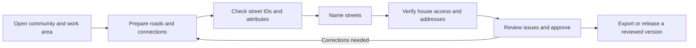

# Community Addressing Cameroon: proposed user flow and toolbox

27 October 2026. Proposal based on the current local application, meeting notes
and `C:/Users/Win10/Dev/todo.md`. This document does not implement accounts,
permissions, approval or publication. The user confirmed the name Community Addressing Cameroon, with Project as a separate label.

## Product purpose

One shared workspace for turning incomplete road and building data into reviewed
community addresses. Different people use different tools on the same project.
Keep the map, selected area, selected object, history and language consistent as
people move between tasks. The community naming page remains a simpler entry.

## Two entry paths

**Resident / visitor:** choose community and language -> find a place or address
-> inspect available access information. Viewing published information should
not require an editor account. A correction report can use a separate simple flow.
The team must decide which survey fields may appear publicly.

**Team member:** sign in -> open an authorised community -> choose an assigned
work area or an issue -> perform the permitted task -> check the result -> submit
for review. Show the next useful task and preserve context when changing tools.

The reference point is project setup owned by the expert/admin. Show it clearly
to other users; requiring every visitor to reconfirm the numbering origin is
unnecessary in the proposed flow. Moving it is a privileged project-wide change.

These are repeatable stages, not a wizard that requires finishing all roads in
Cameroon before naming one street. Work on a bounded Fotouni area, review it,
then expand. A geometry change can make downstream results stale; recomputation
must not count as human approval or silently discard earlier decisions.

## Toolbox structure and todo coverage

| Workspace | Main subtools | Todo coverage | Current foundation / remaining work |
|---|---|---|---|
| Overview and work areas | Area selection, assignments, progress, next task, blockers | 1.5, 5, pilot planning | Area grid/progress exists. Assignments, per-object review and a dashboard remain proposed. |
| Roads | Import, draw, freehand, reshape, cut, delete/restore, extend, connect, mark uncertainty | 1.1-1.4, 1.6-1.8 | Most basic editing tools now exist. Shared-junction movement, near-miss checks and complete change-export verification remain. |
| Street identity and attributes | Group under one ID, split IDs, rank, drivability, surface, noaddress | 2.1, B1-B4, 2.3 | ID preflight and recomputation fixes partly implemented. Stable identity, edge attributes and noaddress remain. |
| Names | Naming priorities, eligibility, first-order derivation, three fields, abbreviations, suggestions, collisions | R1-R3, 3.2-3.4, 7 | Existing naming/planner/simple page remain. Requested rules, structured names and migration remain. |
| Homes and access | Select building, inspect door bearing, choose actual road access, flag uncertain access, validate address | 4, 4.1, 4.2 | Manual road-point selection and azimuth-based logic exist. House-specific uncertainty and complete validation remain. Road-end uncertainty is not a house-access review. |
| Signs and delivery | Street/direction sign previews, lists, address/street exports, OSM change preview | 4.3, 4.4, 6.1-6.6 | Several exports/signs exist. Requested sign rules and full export acceptance tests remain. |
| Review and history | Issues by area/object, before/after, reasons, approve/return, checkpoints, review invalidation | 1.4-1.6, 3.4, 5 | Warnings, events, Undo/Redo and checkpoints exist. Identified authors and reliable approval/audit do not. |
| Administration | Invitations, roles, project settings, reference point, backups, release and hosting | 5, 8 | Proposed. Current deployment is one process per project; a workspace selector alone would not add a multi-project backend. |

Do not turn every subtool into another top-level tab. Keep the existing map;
show a small set of task stages, then a relevant tool panel. Put common actions
in both the panel and the road context menu so keyboard/touch users have an entry.
Keep destructive actions distinct from drawing actions.

Two actions must remain clearly different:

- **Connect roads:** establish an actual shared graph junction for routing.
- **Group street ID:** classify connected segments as the same named street.

Connecting a route does not require merging street IDs. Conversely, assigning
the same ID does not create a physical connection across a gap.

## Proposed screen organisation

- Header: community, language, account, saved/computed/review status.
- Stage navigation: Roads, Street IDs, Names, Homes, Review, Delivery.
- Map: primary workspace, selected area and clear feature highlight.
- Context panel: only tools and instructions relevant to the selection/task.
- Issue queue: actionable warnings with location, owner and resolution status.
- History drawer: selected object's edits, before/after and associated decisions.
- Administration: separate from everyday mapping and community naming.

The current four tabs are a useful foundation; these are proposed extensions,
not a reason to replace Leaflet or rebuild the whole app in another framework.
Implement changes incrementally while keeping existing edit workflows tested.

## Accounts and responsibility

Individual accounts are needed for trusted attribution once more than one
person edits. A free-text name field or a shared login cannot establish who
actually made an edit. Resolve the actor on the server from a verified session;
ignore any caller-supplied author as proof of identity.

| Access | Proposed capability |
|---|---|
| Public visitor | Read approved information; no edit permissions. |
| Community contributor | Propose names and report incorrect/uncertain access in authorised areas. Cannot alter geometry or project settings. |
| Mapper / GIS expert | Edit roads, connections, IDs, attributes and house access; inspect computations; submit work for review. |
| Project administrator / reviewer | Manage memberships, review or return work, change global settings/reference, restore checkpoints and authorise releases. |

For the pilot, reviewer and administrator can be the same person. They remain
separate capabilities so the team can separate responsibilities later. Do not
assume a minimum headcount. Prefer invited editors initially; public sign-up and
social account features are unnecessary for the core pilot.

Permissions must be enforced on API routes, not only by hiding buttons or
directing people to `/simple`. Check community membership on every project
operation. Include session expiry/logout and a recovery process. Agree the
authentication mechanism with the intended host before selecting a provider.

## What an attributed edit should retain

Store stable actor ID (with display name), timestamp, community, work area,
stable object reference, operation, previous/new values, project revision,
optional reason, and review outcome/reviewer. Preserve deleted-feature geometry
so a reviewer can inspect the location. Computed changes must be distinguishable
from direct human edits and linked to the source input revision.

Example: an identified mapper reshapes a road; the timeline shows its before/
after geometry and reason. A reviewer requests a correction or approves it.
Recomputation produces results for that input revision. An approved release
records its reviewer and version. Later edits do not silently change that release.

Use separate states for **saved**, **computed**, **reviewed** and **released**.
Autosaving only establishes persistence. A green area progress label is not
proof that its geometry, house access and addresses are all approved.

Current evidence:

- `app/server.py:me()` returns `""`; the API has no authenticated editor identity.
- `app/store.py:_add_event()` stores time, user, operation and old/new values.
- `_add_event()` deletes this author's previously undone events when recording
  a new edit. That is not an append-only audit trail.
- `Store.undo()` / `redo()` act on the author field. Today the empty author is
  shared. With identified authors, dependent edits by other people still need
  conflict-safe reversal; existing per-author filtering alone does not solve it.
- Checkpoint restoration changes shared project state; it should be privileged
  and recorded, including the actor and reason.

Keep the existing event system as the foundation, but preserve undo/redo and
restore actions as additional audit records rather than erasing decisions.
Migrate old anonymous events as **unknown / legacy**. Never assign them to Miguel
or another person without evidence. No login screen can recover past identity.

## Pilot implementation order

1. Agree roles, access scope and one bounded Fotouni trial area; identify a
   reviewer and representative tasks for each user group.
2. Add trusted sign-in, API permissions and append-only attribution before
   multi-user editing. Test two editors, conflicts, Undo and restore together.
3. Add the area/task overview and per-object review with issue resolution;
   preserve useful map context across all subtools.
4. Finish the underlying blockers from the todo: R1/R2/R3, identity stability,
   required road attributes and the agreed naming model. A new menu does not
   implement these rules.
5. Validate the bounded area's house access, agreed numbering, signs and exports;
   run an observed trial with representative residents and editors.
6. Release a reviewed snapshot, verify recovery and hosting under expected load,
   then expand to other areas/communities.

Keep the branding task small and parallel to this work. No authentication,
approval, publication or OSM-upload behaviour was added by this design proposal.

## Logo options

`logo-options/index.html` compares three original native SVG concepts: A Home &
path, B Reference & routes, C Shared map. It supports a working-name preview,
dark background and a one-colour check. Individual transparent SVG files and
comparison PNGs are in the same folder. These are earlier explorations. The user subsequently selected a supplied pin/house/road PNG; it is now used in both app pages.

Suggested starting direction: A for addressing and reaching homes; C if the
team prefers the broader mapping-tool identity. The project name is confirmed. Choose a logo direction before refining and implementing the mark.

Selected artwork: user-supplied transparent PNG. The compact header shows the pin using CSS clipping; the reference card shows the complete artwork. No raster pixels or original background were changed.
